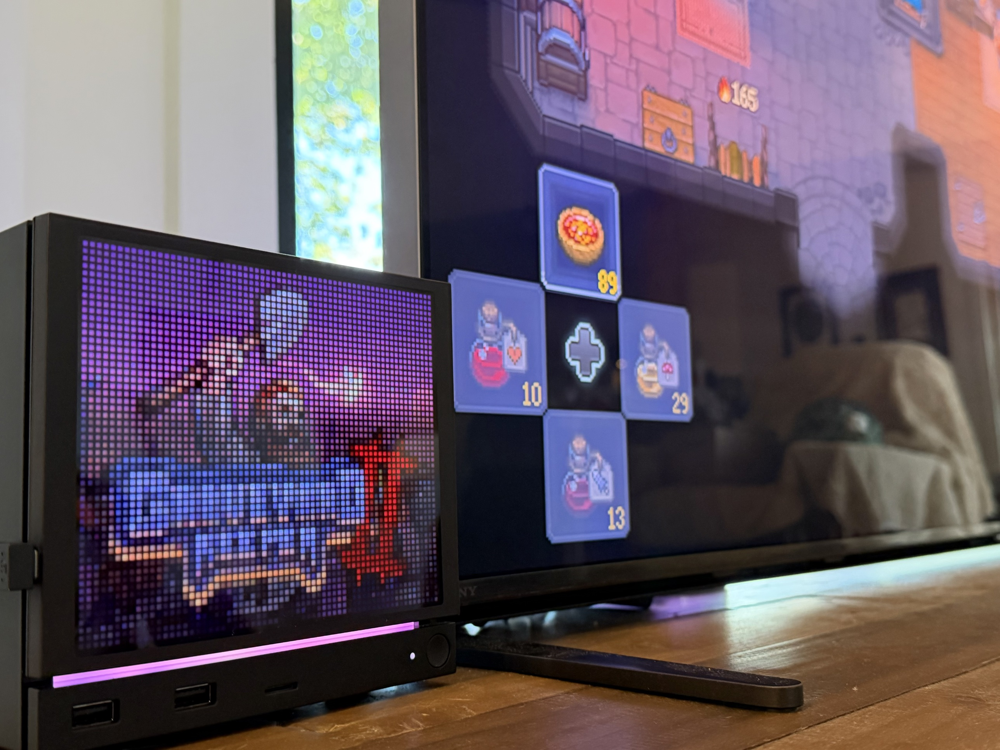
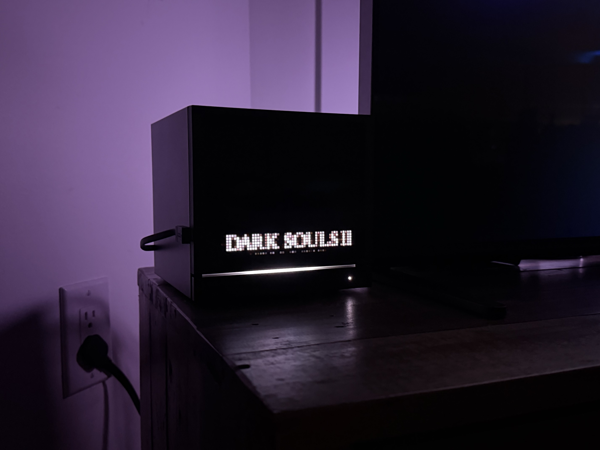
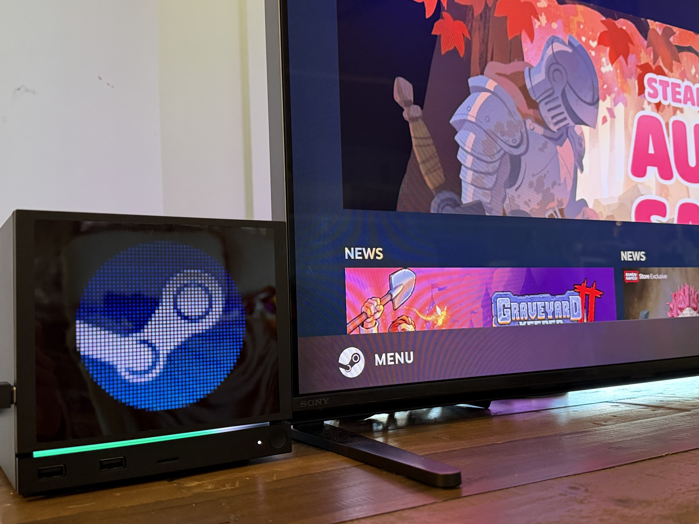

# Pixel Faceplate

A Decky plugin for the [JSAUX Pixel Matrix Faceplate](https://jsaux.com/products/faceplate-for-steam-machine?variant=52269891813596) on the Steam Machine (the 64x54 RGB one, not the e-ink one). It talks to the panel directly over USB, so you don't need JSAUX's own software (JSAUX PIXEL: an app, a background daemon and an installer).



## How this went

This started as a fun little plugin. The faceplate showed up one morning, I took it apart, worked out how JSAUX's software talks to it over coffee, and wrote my own Decky plugin so I didn't need theirs. Anything I couldn't do yet I figured was just stuff I hadn't figured out, and it'd all get way easier once JSAUX posted their source like the product page kind of promises ("supports open-source code").

It turned into a rabbit hole of really bizarre hardware choices. The panel saves every picture you send it to flash, there's no command to just draw on it, and JSAUX's own app redraws its clock and stats screens as a brand new picture about once a second. A bright enough picture browns out the USB-A port it ships for. The controller chip has its markings sanded off. There's a command their app never sends that takes a whole data transfer and pops up a "download failed" icon when it times out, which looks a hell of a lot like a firmware loader, while JSAUX says the hardware can't be updated.

And the source? Support told me they're "unable to disclose specific information at this time." Then JSAUX [announced](https://www.reddit.com/r/JSAUX/comments/1x4t6pg/faceplate_app_will_be_opensourced_on_github_after/) the app gets open-sourced once Steam approves it. Just the app, not the firmware or the protocol, and Steam approval has nothing to do with putting code on GitHub.

So I clipped onto the flash chip with a Raspberry Pi and dumped it before and after every command I could send. Honestly I figured it'd be boring, a normal file system and normal flash management. It's worse than that. There's no file system and no wear leveling, just a settings record and the picture rewritten in the same few spots every time, and the chip comes from a maker that never registered its ID, so there's no datasheet saying how many writes it's good for. If it's the usual 100,000, their clock screen gets there in about 28 hours. Then I put pogo pins on every pad I could reach, looking for a debug port to read the firmware out, and nothing answers. Could be a cheap chip that never had one. Could also be locked, which is literally a checkbox when it gets flashed at the factory, and between the sanded markings and how weird they've been about the source I'd say that one's very much on the table.

Everything I found is in this repo, with the raw data, so you don't have to take my word for any of it:

- [PROTOCOL.md](PROTOCOL.md): the serial protocol, every command, the board, and what writes the flash.
- [flash/](flash/README.md): every flash dump (stock backup included), diff reports, chip ID, the scripts and how to repeat the whole thing on a Pi.
- [flash/SWD.md](flash/SWD.md): the debug port hunt, pad by pad, with the raw logs.
- [docs/WRITEUP.md](docs/WRITEUP.md): the long story of figuring out the protocol, with photos.
- [docs/VENDOR-SOFTWARE.md](docs/VENDOR-SOFTWARE.md): what JSAUX's own software actually does.

The rest of this page is the plugin, which only sends the panel something when it actually has to.

> **Use at your own risk.** I put this together over coffee one morning, poking at the faceplate, and it has only been tested on my own Steam Machine, doing what I do with it. You're welcome to install it and use it, but I don't consider it ready for wide distribution and I'm not submitting it to the Decky store. I'm old as dirt and was a software engineer in a past life. These days I do this for fun, including a lot of custom ESP32 firmware for smart home stuff around my house, so I think it's in decent shape. I'm mostly sharing it so the next person who wants to do cool stuff with this panel doesn't have to start from scratch. Still, it talks directly to hardware that stores everything in flash and can brown out a USB port. You've been warned.

> **This is most likely the last version.** I'm still working on the hardware side, but anything new will go to [GabeCubeAura](https://github.com/Alyenax/GabeCubeAura) as pull requests instead of into this plugin. Updating this one by hand is a pain, and GabeCubeAura seems like a better home for it. Whether GabeCubeAura takes faceplate support is up to its author. If it does, this plugin steps aside on its own (0.2.1 or newer) and you can uninstall it. Until then, update this one or leave it as it is, whichever you like.

## TL;DR

### What you need

- A Steam Machine running SteamOS with [Decky Loader](https://github.com/SteamDeckHomebrew/decky-loader) installed. Tested on SteamOS 3.8.28 with Decky 3.2.10.
- The JSAUX Pixel Matrix Faceplate, plugged in with the USB cable it came with.
- That's it. The plugin only uses Python's standard library and GStreamer, which both ship with SteamOS, so there's nothing to pip install and it doesn't need root.

### Install (short version)

1. Download `Pixel-Faceplate-v<version>.zip` from the [Releases page](https://github.com/hodapp/pixel-faceplate/releases).
2. Decky > Settings: turn on Developer mode.
3. Decky > Settings > Developer > Install Plugin from ZIP File, and pick the ZIP.
4. Quick Access menu > Decky > Pixel Faceplate, and choose a mode. It starts in Off, so nothing changes until you do.

New to Decky, or not sure? Use the [step-by-step guide](#install-step-by-step) below.

### Before you start

- Every picture you send gets saved to the panel's flash memory, always to the same spot, and flash wears out with use. The plugin only sends a picture when it actually changes. See [Flash wear](#flash-wear).
- A very bright picture at full brightness can draw more than a USB-A port supplies, and the panel then browns out. The plugin turns brightness down for those pictures to stay under the limit I measured. See [Power](#power-usb-a-versus-usb-c).

## Install, step by step

**Please read this first.** Don't install this if you don't know what you're doing, and don't expect production-quality software. This is me messing around over coffee. It works well on my Steam Machine, but it talks straight to hardware, and if something goes wrong you'll be the one sorting it out.

Still here? OK.

### 1. Install Decky Loader

Skip this if you already have it.

1. Press the Steam button, go to Power, and choose Switch to Desktop.
2. In Desktop Mode, open a web browser and go to [decky.xyz](https://decky.xyz).
3. Download the installer and run it. If your deck user has no password yet, it asks you to set one. When it asks which version, pick the latest release.
4. When it's done, double-click "Return to Gaming Mode" on the desktop.

### 2. Turn on Decky's Developer mode

1. Press the `...` button to open the Quick Access menu.
2. Scroll down to the plug icon (that's Decky) and open it.
3. Select the gear icon at the top to open Decky's settings.
4. Under General, turn on Developer mode.

### 3. Download the plugin onto the Steam Machine

1. Switch to Desktop Mode again (Steam button > Power > Switch to Desktop).
2. Open a web browser and go to this repo's [Releases page](https://github.com/hodapp/pixel-faceplate/releases).
3. Under the newest release, click `Pixel-Faceplate-v<version>.zip` to download it. Don't unzip it. It should end up in your Downloads folder.
4. Go back to Gaming Mode.

### 4. If you installed JSAUX's software before, remove it

Only one program can talk to the faceplate at a time. If you never installed JSAUX's software, skip this. If you did, go to Desktop Mode and either double-click "Uninstall JSAUX PIXEL.desktop" from the folder you installed it from, or open Konsole and run:

```
systemctl --user disable --now jsaux-matrix-hub
```

### 5. Install the plugin

1. Open the Quick Access menu (`...`), go to Decky, and open settings (the gear).
2. Go to Developer, and choose Install Plugin from ZIP File.
3. Browse to your Downloads folder and pick the `Pixel-Faceplate-v<version>.zip` you downloaded.
4. Confirm the install.

### 6. Plug in the faceplate and turn it on

1. Make sure the faceplate's USB cable is plugged into the Steam Machine.
2. Open the Quick Access menu, go to Decky, and select Pixel Faceplate.
3. Change Mode from Off to Game artwork.
4. The Status section should say Connected. Start a game and its artwork should show up on the faceplate within a few seconds.

### Updating

The plugin doesn't update itself, and it isn't in the Decky store, so nothing will tell you when there's a new version. To update, download the newest `Pixel-Faceplate-v<version>.zip` from the [Releases page](https://github.com/hodapp/pixel-faceplate/releases) and install it the same way as step 5. It replaces the old version. Your settings are stored separately by Decky, so they carry over. The version you're running is shown in Decky's plugin list.

It's worth updating to at least 0.2.1. That's the version that steps aside on its own once GabeCubeAura can drive the faceplate (see [If GabeCubeAura runs the faceplate](#if-gabecubeaura-runs-the-faceplate)).

### Uninstalling

Quick Access menu > Decky > gear > Plugins, find Pixel Faceplate, and uninstall it. The faceplate keeps showing whatever it last displayed until something else sends it a picture.

## Modes

- Off: Leaves the panel alone and lets go of the serial port. The panel keeps showing whatever it last stored.
- Game artwork: When you launch a game, the panel shows the game's wide hero art with its logo over the bottom. The logo is pushed to full brightness over a slightly darker band, and the art's midtones are lifted, because even at maximum the panel is much dimmer than the Steam Machine's light bar. It finds the running game and its art the same way [GabeCubeAura](#thanks-gabecubeaura) does, so your SteamGridDB custom art is used if you have it. That includes non-Steam games you've added to Steam, which only have the art SteamGridDB put in the grid folder. A Steam game whose art isn't in the local library cache (some games that start through a launcher) gets it from Steam's CDN once, kept in the plugin's folder. Between games it shows the Steam logo (drawn from the icon SteamOS already has), the clock, the last game's picture, or random pictures, whichever you pick.

  Random pictures come from free sources that don't need a key: space photos from [NASA's image library](https://images.nasa.gov), the whole Earth from [NASA EPIC](https://epic.gsfc.nasa.gov) (a new shot every couple of hours, from a million miles out), public domain paintings from the [Art Institute of Chicago](https://www.artic.edu/open-access), twinkling stars drawn right on the console (one upload, then the panel slowly fades them in and out on its own), or cats from [TheCatAPI](https://thecatapi.com) with [CATAAS](https://cataas.com) as a backup. Pick one, or "A bit of everything", which takes turns between all of them except the cats. A new one comes every 1, 3, 5 or 10 minutes (10 by default), and there's a Next picture button. The last 40 from each source are kept, so with no network you get ones you've already seen. The stars need no network at all, so the mix always has something, and a single source with nothing to show falls back to the Steam logo. If you had Random cats picked before, you still get cats.

  Artwork style picks how the game is drawn:
  - Art + logo, shaded behind logo: the art darkens toward the logo so the title reads on busy art. This is the default.
  - Art + logo: the same without the shading. Better when the art is already dark at that end, or the shading eats too much of the picture.
  - Art only: no logo.
  - Logo only: the logo as big as it fits, on black. Games without a logo show their art instead.

  The logo can go at the top, center or bottom, in any style that shows it. The shading follows it.

  

  Style and logo position apply to every game unless you say otherwise. While a game is running, turn on "Just for" that game and the two settings below it change for that game only. It starts from your usual choices, so nothing changes until you pick something. Turn it off and the game goes back to your usual style. Everything else (brightness, upside down, sleep) is for the whole console.

  

- Clock: Large digits in a color of your choice, 12 or 24 hour. Redrawn once a minute.
- Light bar aura: Copies the Steam Machine's light bar colors onto the panel as a glow, so it follows GabeCubeAura or Steam's own LED effects. It checks once a minute by default and ignores small changes.
- Custom image: Any PNG, JPG, GIF or BMP on the Steam Machine, cropped to fit.

If your faceplate is mounted upside down so the cable comes out the right side, turn on Upside down and everything is flipped to match. The included cable won't reach from that side, so you'll need a longer one.

There's also a brightness slider, and a counter showing how many pictures have been written to the panel's flash, this session and in total.

### Sleep and shutdown

The Steam Machine keeps its USB ports powered while it sleeps, so on its own the faceplate would show the last picture all night. You can choose what happens when the Steam Machine sleeps and when it shuts down: turn the screen off (the default), dim it, or keep the picture. Turning the screen off is a power command, not a new picture, so it doesn't cost a flash write. When the Steam Machine wakes up, the screen comes back on at your brightness.

It works by listening for the system's own sleep and shutdown announcements, and holding a short delay lock so the system waits a moment for the panel before going down. That works in Gaming Mode and Desktop Mode.

## Flash wear

The panel stores whatever you send it and shows it again after a power cut. That's on purpose: the faceplate keeps working with the Steam Machine off or with no software running. The catch is that every picture is a write to flash memory, and I've now read the chip directly to see exactly what that means.

The chip is U22, a CIU25Q016B, 2 MB of SPI flash. Every new picture erases the settings sector at the start of the chip and the same sectors for the picture itself, at the same addresses every time, twice over (it lands in a buffer first and gets copied once its CRC checks out). Changing the brightness rewrites the settings sector. So does picking one of the panel's built-in animations, and that also makes it forget the picture it had, so going back to it is a full write again. Nothing spreads the wear around. Screen off and on, booting, and sending a picture it already has cost nothing.

Chips like this are typically rated for around 100,000 erases per sector. I couldn't find a datasheet for this one, so that's an assumption, and real chips usually outlast their rating. At 100k:

| What's uploading | How often | Rated life of those sectors |
|---|---|---|
| JSAUX's app on its clock, stats, playtime or timer screens | about once a second | about 28 hours |
| a clock that redraws once a minute | once a minute | about 69 days |
| this plugin on game artwork | once per game launch | decades |

JSAUX has also said that still images don't write flash and that only GIFs over 20 KB do. Neither is true. I cut the panel's power after uploads from 1 KB to 30 KB, still and animated, and every one came back, and the dumps show a 348 byte still picture getting written like any other. The dumps, the diffs and how to repeat it are in [flash/](flash/README.md), and the short version is in [PROTOCOL.md](PROTOCOL.md#9-flash-layout-and-what-writes-it-seen).

So the plugin is careful with writes:

- It only sends a picture when it's different from the last one, never more than once a second.
- If the panel already holds the exact same picture it says so, and nothing gets written.
- Artwork costs one write per game, the clock one per minute, random pictures one per new picture (so one a minute at the fastest setting, the same as the clock), and the aura usually a few per hour.
- Brightness only goes out when it actually changes. Every change is a write though, so don't sit there sliding it back and forth. A bright picture that has to be turned down costs a brightness write on the way in and another when the next picture goes back up.
- Turning the screen off for sleep costs nothing. "Dim" costs up to two writes per sleep, one to dim and one to put it back.

There's no screen mirroring mode for this reason. Mirroring a game at 2 frames per second would burn through 100,000 writes on those sectors in about 14 hours.

## Power: USB-A versus USB-C

The faceplate comes with a USB-A cable and is rated at up to 3.5 W. A USB-A port is only meant to supply about 2.5 W. With normal pictures that's fine: game art and solid red ran at brightness 100 with no trouble. Solid white at brightness 100 did not. The panel browned out, and a Steam Controller dongle on the other USB-A port dropped at the same moment and needed unplugging and replugging.

Worse, the panel then got stuck restarting, because it shows its stored picture at its stored brightness every time it powers on. Moving it to the USB-C port gave it enough power to start, and `tools/rescue.py` blanked it.

I measured the limit on USB-A with solid white: brightness 40, 50 and 60 each held for 8 seconds, and 70 browned out straight away. The plugin works out how much light each picture needs (brightness times the average pixel level) and keeps that under 0.50, a bit below the 0.60 that held. Game art and the clock run at whatever brightness you set. A mostly white picture gets turned down, to 50% for solid white, and the Quick Access panel tells you when that happens. Brightness is always lowered before a bright picture is sent, never after.

## If something goes wrong

- If the panel says "Faceplate not found", check the cable and make sure nothing else has the serial port open (the JSAUX daemon, for example). The panel shows up as a CH340 serial device, `1a86:7523`.
- If the panel keeps restarting, flashing or showing glitchy lines, it's probably starting up into a picture that's too bright for the port. Copy this repo's `tools` and `py_modules` folders to the Steam Machine, run `python3 tools/rescue.py` from that folder, then plug the panel into the USB-C port. The script turns the screen off the moment the panel appears, stores a black picture and turns the screen back on. After that it's safe to go back to USB-A.
- If the status says the faceplate is in use by another app, something else is driving it, usually GabeCubeAura's faceplate support. Only one can have it at a time; turn one of them off and the other picks it up within a few seconds.
- If the panel cycles through red, green, blue and white with scanning lines, it's in its factory test mode (holding the L pad on the board to ground at power-up starts it, and it stays on across restarts). From this repo's folder, run `python3 tools/bootprobe.py /dev/ttyUSB0 testoff` with the plugin set to Off. The test pattern includes full white, so if the panel keeps restarting on USB-A, do this on the USB-C port.
- If a game's art doesn't show up, start the game, then press Write diagnostics report in the Status section. It writes `~/pixel-faceplate-diagnostics.txt`: which app ID the plugin got and from where (Steam's UI, launch events, `/proc`), the accounts in `loginusers.vdf`, and which folders it looked in for art.
- The plugin logs to Decky's log: `journalctl -u plugin_loader | grep "Pixel Faceplate"`

## How it works

The short version: the panel is a CH340 USB serial device at 1,000,000 baud. Messages start with "DY", carry a command and a CRC, and pictures go up as GIFs in 498-byte chunks. [PROTOCOL.md](PROTOCOL.md) has every command, timing, what's on the board and what lands in flash. The rest of the docs are listed under [How this went](#how-this-went).

SteamOS doesn't have Pillow or pyserial, so the plugin has its own small GIF encoder, opens the serial port with `termios`, and decodes artwork with GStreamer.

## Building from source

You need Node.js with pnpm and Python 3.

```
pnpm install
pnpm build        # frontend -> dist/index.js
pnpm test         # Python tests (the GIF round-trip tests also want Pillow)
pnpm package      # out/Pixel-Faceplate-v<version>.zip
```

`tools/` holds the scripts used to work out the protocol: `probe.py` (send commands by hand), `scan.py`, `sizetime.py`, `steptest.py`, `rescue.py`, `bootprobe.py` (looks for a bootloader, and turns factory test mode off), the `lab*.py` bench tools (`lab_camfuzz.py` watches the panel with a camera while it sends commands), and the flash and SWD tools that run on a Raspberry Pi (`u22.sh`, `flashdiff.py`, `chipid.py`, `testgifs.py`, `swd-pi5.cfg`, see [flash/](flash/README.md#how-to-repeat-it)). Read their headers before running them. A few of them write to the panel's flash or push it towards its power limit on purpose.

## Thanks, GabeCubeAura

This plugin exists as quickly as it does because of [GabeCubeAura](https://github.com/Alyenax/GabeCubeAura) by Alyenax. If you have a Steam Machine and haven't tried it, go install it: it drives the light bar with game artwork colors, launch animations, performance meters, screen sync and weather, and it's very well made.

Reading its source taught me most of what I needed to know about building a Decky plugin for the Steam Machine: how to structure the backend, how to tell which game is running (Steam's launch and exit events, with a fallback), and where Steam keeps game artwork, including SteamGridDB custom art and the newer cache layout. Pixel Faceplate's code is new, but on those points it follows GabeCubeAura's approach, and the two plugins pick the same artwork for the same game. GabeCubeAura is BSD-3-Clause licensed. Thank you, Alyenax.

### If GabeCubeAura runs the faceplate

I've offered GabeCubeAura the faceplate code so it can drive the panel itself. If it ever does, this plugin gets out of the way on its own: once it sees a GabeCubeAura that drives the faceplate, it lets go of the panel, stops sending pictures and stops handling sleep, and its panel just tells you to set things up in GabeCubeAura and uninstall Pixel Faceplate. If you switch GabeCubeAura off in Decky, this plugin takes over again.

## License

BSD-3-Clause. Not affiliated with JSAUX or Valve.
