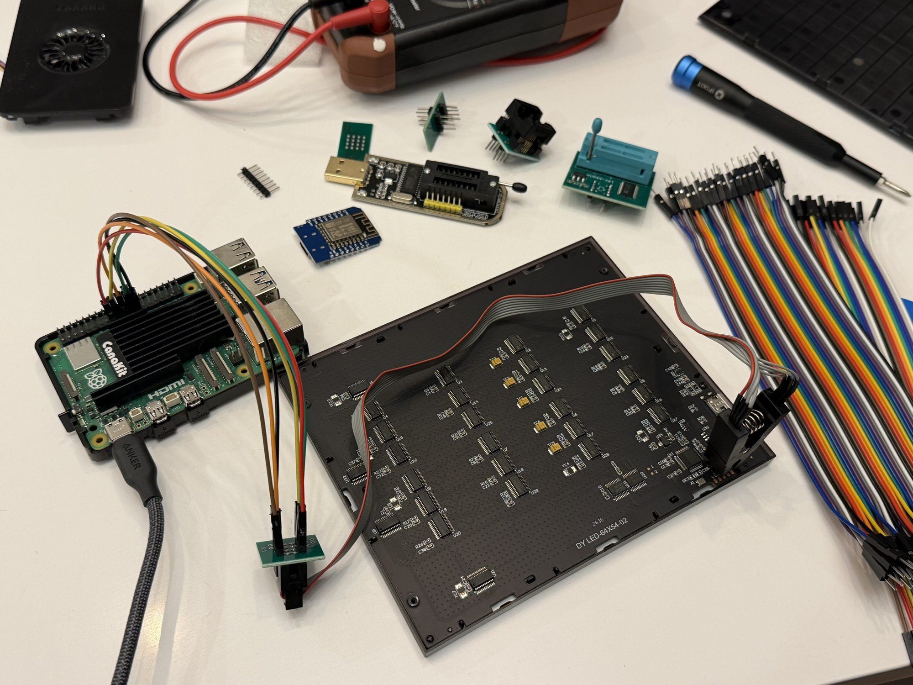

# Reading the faceplate's flash chip

This is everything from the nights I clipped onto U22, the 2 MB flash chip on the back of the faceplate, and dumped it before and after every command I could send the panel. All the dumps are in this folder, raw, along with the diff reports, the test GIFs, the log of every frame I sent, and the scripts. If you've got a faceplate and a Raspberry Pi you can redo every step of this, and I'd honestly love it if somebody did. Where something's a guess I say so.

Short version: there's no file system and no wear leveling. Every GIF upload erases the same few sectors at the same addresses, every time. Sector 0 holds a 256 byte settings record, the live picture sits at 0x0A000, and uploads stream into a buffer at 0x3C000 first and only get copied over to 0x0A000 once the CRC checks out. Brightness changes and picking a built-in animation rewrite sector 0 too. And none of the firmware is on this chip, it's all inside the MCU.



## What's in this folder

| Path | What |
|---|---|
| `u22-stock-2026-10-16.bin` | the stock backup, read 3 times (2, 2 and 8 MHz), all identical. sha256 `bd2b46f2a2f72c9ddcdc76ffe4cc704cc20a0c531b0a53364e5a8fd763cc3d4a` |
| `run1/` | the first upload test: two GIFs (`red1k.gif`, `green5k.gif`), the dump after each, and `flashdiff.py diff` output for each step |
| `run2/` | one command at a time, steps t0 to t14 (table below): a dump after every step, a diff report per step, the test GIFs, `SHA256SUMS`, `t11-busy.txt` (brightness timing) and `u22-chipid.json` (chip ID answers) |
| `run2/garbled/` | reads that came back wrong because the MCU was reading the chip at the same time. Kept so you can see what that looks like, don't use them |
| `run2/panel-log.jsonl` | every frame sent to the panel during run 2, timestamped, with the reply status. GIF chunks are cut to their first 16 bytes |
| `panel-log.jsonl` | the same log carried on through the SWD session (the extra lines are the screen-on pings I used to check the panel was still alive) |
| `SWD.md`, `swd-logs/` | trying to get at the MCU over SWD, and the raw OpenOCD and gpiomon output |
| `photos/` | the chip markings, the pads, the pogo pins, the bench |

The scripts are in [`../tools`](../tools): `u22.sh` (switch the clip between read and idle, take a verified read), `flashdiff.py` (upload a test GIF, send one command, diff two dumps), `chipid.py` (read-only chip ID), `testgifs.py` (the numbered test GIFs), `flashtest.py` (the power-cut test from PROTOCOL.md) and `swd-pi5.cfg` (OpenOCD, read-only).

`SHA256SUMS` in this folder covers every file in it. To check the lot, `cd flash && shasum -a 256 -c SHA256SUMS` (or `sha256sum -c` on Linux).

## How to repeat it

### What you need

- A Raspberry Pi 5. I used Raspberry Pi OS Lite 64-bit (Trixie). A Pi 4 should work too but I haven't tried it.
- A SOIC-8 test clip with its little adapter board. The cheap ones that come bundled with a CH341A programmer are fine.
- Female-female jumper wires.
- A multimeter, for checking the ground.
- Don't use the bundled CH341A itself. The common black ones run their data lines at 5 V and U22 is a 3.3 V part. The Pi's GPIO is 3.3 V, so that's what I went with.

### Pi setup

```
# /boot/firmware/config.txt
dtparam=spi=on

sudo apt install flashrom openocd gpiod python3-serial python3-spidev
```

Copy this repo's `tools` and `py_modules` folders to the Pi. The scripts expect them next to each other. Mine's called `faceplate-pi`, which is the name you'll see in the tool headers.

### Wiring

Pi header pin → clip adapter pin:

| Pi pin | signal | adapter pin | U22 |
|---|---|---|---|
| 17 | 3.3 V | 8 | VCC |
| 25 | GND | 4 | GND |
| 24 | CE0 | 1 | CS |
| 21 | MISO | 2 | DO |
| 19 | MOSI | 5 | DI |
| 23 | SCLK | 6 | CLK |

WP and HOLD (adapter 3 and 7) can stay loose, the board pulls them up. Pin 1 on U22 is the dot at the R10 end.

The ground tooth on pin 4 is the one that slips. If the chip ID comes back all zeros, or VCC at the chip reads around 2.5 V, you've lost ground. Check the G pad on the bottom header to the black wire, it should beep.

### Power: only ever one source

This is the important bit. To read, the faceplate's USB is unplugged and the Pi's 3.3 V on pin 17 feeds the chip through the clip. That also powers the rest of the board's 3.3 V side, the MCU included, and even lights the LEDs a dim red. I measured 3.1 V at the chip.

To upload, pull the 3.3 V jumper off pin 17 first, then set the four SPI pins to plain inputs so the clip is just a passive tap, then plug the faceplate into one of the Pi's USB ports. Never both at once. (I slipped once and had both on for about a minute, nothing was reading or writing and the panel was fine, but don't.)

### Reading

```
# clip on, panel USB unplugged, red jumper on pin 17
sh tools/u22.sh read dumps/stock.bin
```

`u22.sh read` refuses if the panel is still on USB. It reads twice at 0.5 MHz and keeps the file only if both reads match.

Two things I learned the hard way:

- With the Pi powering the board, the MCU wakes up and, if it's showing a GIF, keeps reading U22 to draw it. Then it fights the Pi for the bus and every read comes out different, basically noise (`run2/garbled/`). Put the panel on a built-in animation before you unplug it and the MCU leaves the chip alone. Screen off doesn't help.
- Read slow. At 2 MHz a static picture still read differently 5 times out of 5 with the MCU awake, at 0.5 MHz it matched. My first three stock reads at 2 and 8 MHz did match each other, no idea why those got lucky.

Even then I had one read with a burst of 364 bad bytes in one sector, so always two matching reads, no exceptions. That's why `u22.sh` does it for you.

### Uploading and diffing

```
# swap to USB: red jumper off pin 17, then
sh tools/u22.sh idle
# plug the panel into the Pi's USB
python3 tools/flashdiff.py upload dumps/run1 green5k static:5000:green   # make and upload a 5,000 byte GIF
python3 tools/flashdiff.py send run2/digit2.gif                          # or upload a GIF file
python3 tools/flashdiff.py cmd brightness 30                             # or one control command
# swap back: panel USB out, red jumper on pin 17, then read again
sh tools/u22.sh read dumps/after.bin
python3 tools/flashdiff.py diff dumps/stock.bin dumps/after.bin dumps/run1/green5k.gif
```

`flashdiff.py` only ever uses the normal GIF path (`04` begin, `02 02` chunks, `0B` end) and the plain control commands. It never sends 0x03, the download channel in PROTOCOL.md. Every frame and reply goes into `~/dumps/panel-log.jsonl`.

`diff` tells you which 4 KB sectors changed, how many bits went 0→1 in each (that's how you spot an erase, see below), and where each GIF you pass it sits in the two dumps.

### Chip ID

```
python3 tools/chipid.py dumps/u22-chipid.json
```

Only read opcodes (9F, 90, AB, 5A, 4B, 05, 35, 15), each sent twice, never write enable.

## Run 1: the dumps

| File | When | sha256 |
|---|---|---|
| `u22-stock-2026-10-16.bin` | stock, before anything, 3 matching reads | `bd2b46f2a2f72c9ddcdc76ffe4cc704cc20a0c531b0a53364e5a8fd763cc3d4a` |
| `run1/u22-after-red1k.bin` | after uploading `run1/red1k.gif`, 2 matching reads | `d0a13a0ad45b5c014ca97316e0512fc2fee48bde20cf6885b9d3057f0dfb6c1b` |
| `run1/u22-after-green5k.bin` | after uploading `run1/green5k.gif`, 2 matching reads | `645c77c0850c0cef68f046da763cbc07dc10c4d62d03eab6bded7f06410f15d2` |
| `run1/red1k.gif` | 1,001 bytes, CRC32 0xa72e2bac, one dim red frame | `46ccce3d89bfb1a944b450274e1a53d832d058c9e46495d0a46723f47560c94b` |
| `run1/green5k.gif` | 5,000 bytes, CRC32 0x521db139, one dim green frame | `b5a610e25a710b951a34b864e80f7f4647dd37dc23d30e123ece79afd3b7d0e4` |

The diff reports `run1/diff-stock-to-red1k.txt` and `run1/diff-red1k-to-green5k.txt` are straight output of `flashdiff.py diff`, rerun them to check.

## Layout

Only 31 of the 512 4 KB sectors in the stock dump hold anything.

| Offset | What | Status |
|---|---|---|
| `0x000000`, 256 B used | settings record. `0x02` display mode (00 GIF, 01 built-in), `0x05` saved brightness, `0x3D` built-in number, `0x0C` u32 LE = stored GIF's size, `0x10` u32 LE = its CRC32. From `0x40` on it looks like RAM structs (LE values around `0x88cc`-`0x8984`, `ff ff ff ff` links) | size/CRC confirmed on every dump, the other fields from run 2, the rest isn't decoded |
| `0x00A000` | the live GIF. Starts on a sector boundary. Bytes past the GIF's end aren't cleared | confirmed |
| `0x03C000` | the upload buffer, 0x32000 (200 KB) after the live copy. After a finished upload it's byte for byte the same as 0x00A000, which is why I first took it for a mirror. t8 below shows what it really is | confirmed |
| everything else | erased (FF) | confirmed |

How I checked the record: in each dump, the CRC32 of the first `size` bytes at 0x0A000 equals the CRC field, and in both runs those bytes equal the GIF I sent, byte for byte.

- stock: size 3825, CRC 0x1ee6342a. So the picture that was up (the Dark Souls III art my plugin sends) was 3,825 bytes, not the 57,856 I first guessed. The 14 sectors after it are left over from an older, bigger GIF that never got erased.
- after red1k: size 1001, CRC 0xa72e2bac, matches the file.
- after green5k: size 5000, CRC 0x521db139, matches the file.

That's why a begin frame gets status 02 ("already stored"): the panel just compares the size and CRC32 you send against this record.

There's no firmware in U22. Every non-FF byte is accounted for by the record and the two GIF copies, there's no ARM vector table, no strings, no "V1.1". The firmware and the built-in animations live in the MCU's own flash.

## What one upload erases

NOR flash can only clear bits (1 to 0) when it programs. Setting a bit back to 1 takes an erase of the whole sector. So if any bit in a sector went 0 to 1 between two dumps, that sector was erased. `flashdiff.py diff` counts those per sector.

Stock to red1k (1,001 B GIF), 3 of 512 sectors changed:

| Sector | bits 0→1 | |
|---|---|---|
| `0x000000` | 10 | erased (record) |
| `0x00A000` | 14,887 | erased (live copy) |
| `0x03C000` | 14,887 | erased (buffer) |

red1k to green5k (5,000 B GIF), 5 of 512 changed:

| Sector | bits 0→1 | |
|---|---|---|
| `0x000000` | 11 | erased (record) |
| `0x00A000`, `0x00B000` | 1,104 and 1,414 | erased (live copy, two sectors) |
| `0x03C000`, `0x03D000` | 1,104 and 1,414 | erased (buffer, two sectors) |

So one upload erases `1 + 2 × ceil(size / 4096)` sectors, same addresses every time. Confirmed on two uploads of different sizes, and nothing else on the chip moved either time.

### The timing backs it up

That count also lines up with how long the panel takes to ACK the end frame. Erase + program costs about 40 ms per sector. I drew a line through just two of PROTOCOL.md's power-cut test numbers (`tools/flashtest.py`, 2026-10-14), the 1 KB and 30 KB ones, and got 31 ms + 39.6 ms × sectors. Those two rows match by construction, it's the five in between that test it:

| GIF bytes | sectors erased | predicted ms | measured end ACK ms |
|---|---|---|---|
| 1,001 | 3 | 150 | 150 (10-14), 140 (run 1) |
| 5,000 | 5 | 229 | 211 (10-14), 221 (run 1) |
| 10,000 | 7 | 308 | 305 |
| 15,000 | 9 | 387 | 400 |
| 19,000 | 11 | 467 | 499 |
| 21,000 | 13 | 546 | 551 |
| 30,001 | 17 | 704 | 705 |

That's also where PROTOCOL.md's "about 19 ms per KB" comes from: two copies is two erases per 4 KB, call it 80 ms per 4 KB, ~20 ms per KB.

## Wear

Each upload erases sector 0 and the first sector of each copy once. So those three sectors take one erase per upload, whatever the GIF is, and they wear out first. The buffer doubles the total erasing but not the per-sector wear.

The part's rated endurance is unknown (more on the chip below). The usual rating for SPI NOR like this is around 100,000 erase cycles per sector, so these numbers assume that:

| Who uploads, how often | uploads to 100k | |
|---|---|---|
| JSAUX's app, clock/dashboard screens re-upload every second ([VENDOR-SOFTWARE.md](../docs/VENDOR-SOFTWARE.md)) | 100,000 | ~28 hours of that screen |
| a clock that uploads once a minute | 100,000 | ~69 days |
| Pixel Faceplate, once per game launch or idle switch | 100,000 | decades |

Real chips usually outlive their rating so those hours and days are a floor, I wouldn't call them a death date. The part I actually measured is that it's the same sectors every upload and nothing spreads the wear around.

## Run 2: one command at a time (2026-10-17 00:00-00:45Z)

Everything in `run2/`, hashes in `run2/SHA256SUMS`, one diff report per step (`run2/diff-*.txt`, each ends with the record bytes that changed). Each step is one swap to USB, the listed command(s) and nothing else, a swap back, then two reads at 0.5 MHz that have to match. The test GIFs are big dim digits so I could tell from across the room which one was up (`tools/testgifs.py`).

| Step | Sent | Sectors changed | What changed |
|---|---|---|---|
| t0 | nothing, just plugged in ~10 s and unplugged | 0 | nothing. Booting doesn't write. |
| t1 | upload `digit1.gif` (348 B, after a looping version of it) | 3 | record size/CRC → 348 / 0xd76e774d, both copies = the file. Same 3 sectors as run 1. |
| t2 | upload the same `digit1.gif` again | 0 | panel answered 02, nothing written. The "already stored" path is free. |
| t3 | upload `digit3.gif` (100,190 B, 28 frames), screen off, screen on, built-in 0 | 51 (1 + 25 + 25) | both copies = the file, 25 sectors each, still from 0x0A000 and 0x3C000. Record: 0x02 00→01, 0x05 64→50, 0x08-09 01 01→00 00, size and CRC zeroed |
| t5 | brightness 30 only | 1 (sector 0) | 0x05 50→1E. Brightness is saved, every change erases sector 0. |
| t6 | built-in 1 only | 1 (sector 0) | 0x3D 00→01. Picking a built-in erases sector 0. |
| t7 | screen off, 2 s, screen on | 0 | nothing saved. Screen came back brighter than 30 though, so screen-on resets the live brightness without writing it |

(There's no t4, I skipped the number.)

t3 bundles four commands because animated GIFs couldn't be read (see "Reading" above), so it doesn't say which command set which byte. t5-t7 split them out after that. My guess for the 0x05 = 0x50 (80): screen-on sets the live brightness to 80 (t7 shows it changes without a write) and the built-in switch then saved it. That's a guess, it fits but I didn't test it on its own, and t8a and t13 knocked it down anyway.

### t8: is the second copy a mirror? No, it's the upload buffer

| Step | Sent | Sectors changed | What changed |
|---|---|---|---|
| t8a | upload `digit2.gif` (4,907 B) | 5 (1 + 2 + 2) | both copies = the file. Record: 0x02 01→00 (GIF mode), 0x08-09 00 00→01 01, size/CRC = 4907 / the file's. 0x05 stayed 1E, so the record write didn't save the brighter live brightness from t7. That kills my guess about where t3's 0x50 came from, it's unexplained. |
| t8b | `digit3.gif` begin + 10 of its 202 chunks (4,980 B), no end frame, then USB pulled | 1 | only `0x03C000`: erased (8,395 bits 0→1) and now holds the first 4,096 bytes of digit3. `0x00A000` still holds digit2 byte for byte, the record still says digit2. |

So an upload streams into 0x03C000 one 4 KB sector at a time as chunks arrive. Only after the end frame does the panel put it in 0x00A000 and rewrite the record. The leftover 884 bytes past the first full sector were never written, they were still in RAM when the power went. A failed upload leaves the old picture alone, good, that's how it should work. It's also why every upload costs the erases twice, once into the buffer and once into the live copy.

| Step | Sent | Sectors changed | What changed |
|---|---|---|---|
| t9 | `digit1.gif` (348 B) with the begin frame announcing CRC 0xd76e774c instead of the real 0xd76e774d | 0 | nothing, same hash as t8b. End answered 00 after 20 ms (a real commit takes 120+ ms). The 2 stayed up on the panel. |
| t10 | brightness 20 only (from 30) | 1 (sector 0) | 0x05 1E→14. But 0x1E→0x14 only clears bits, and NOR can clear bits without an erase, so this dump doesn't prove an erase (0 bits went 0→1). t5 (0x50→0x1E) did. So "a brightness change that needs a bit set erases sector 0" is proven, "every change erases" isn't, from dumps alone. |
| t11 | brightness sweep with timed pings (`run2/t11-busy.txt`), last value 60 | 1 (sector 0) | 0x05 14→3C, the last value sent. |
| t12 | built-in 0 only (from GIF mode, brightness 60) | 1 (sector 0) | 0x02 00→01, 0x3D 01→00, 0x08-09 01 01→00 00, size/CRC zeroed, brightness left at 3C. The digit2 data stays in 0x00A000, only the record forgets it. This is t3's record change without the other three commands, except brightness. |
| t13 | screen off, screen on, built-in 1, one session | 1 (sector 0) | only 0x3D 00→01. Brightness stayed 3C. That kills my second guess for t3's 0x50 (screen-on resetting the live brightness, then the next record write saving it). t3's 0x50 is unexplained and I'm leaving it there, nothing else depends on it. |
| t14 | upload `digit2.gif` again. It's still sitting in 0x00A000, but t12 cleared the record | 2 visible | begin answered 01, not 02, end ACK 281 ms (t8a's first upload of the same file: 261 ms). Record back to digit2. 0x03C000 erased (7,255 bits 0→1), it had t8b's half-written digit3 in it. The other sectors got the same bytes written back, so a dump can't see them, the end-ACK time says it was a full write. |

So the end frame checks the CRC and won't commit a bad upload. And because nothing at all got written, data under 4 KB is held in RAM until the end frame. Only full 4 KB sectors stream into the buffer early (t8b), the rest waits for the CRC check.

So after a built-in switch, going back to a picture the panel already holds is a full re-upload and another sector 0 erase. Proven for sector 0 and the buffer's first sector by bit flips, for the rest by timing.

t11, timing. Brightness frames get no reply, so I sent a screen-on ping (writes nothing, t7) right after each one and timed its answer (`flashdiff.py busy`). A normal ping answers in 20-40 ms.

- Control, screen-on then an immediate ping: answered in 20-40 ms. Back-to-back frames are fine.
- Same brightness again (25 → 25, four times, ping 10-40 ms later): answered normally, no stall.
- A change that needs a bit set (25 ↔ 38, four times): ping sent 100 ms later took 80-100 ms to answer, so the panel was busy ~180-200 ms.
- A change that only clears bits (63 → 62, 61 → 60 and so on): the same 180-200 ms.
- One ping sent 0 ms after a same-value brightness frame got no answer at all, the same ping at 10 ms was fine. I think the two frames just collided, I don't think it was doing any work.

So the panel does nothing on a repeated value, and does the same ~190 ms of work on every real change, whichever bits move, and the dumps show the new value saved each time. t5 proves that work includes an erase at least when a bit has to go 0→1. The plain reading is that every brightness change erases and rewrites sector 0. What the timing can't rule out is some other ~190 ms job, a fade for example, on a clear-only change.

Two things that matter for the wear story:

- Going to a built-in zeroes the stored GIF's size and CRC. The picture's still sitting there, but sending it again won't get 02 any more, it's a full re-upload. So bouncing between a built-in and a GIF costs erases every time.
- JSAUX said on Reddit (2026-10-10) "static images and built-in displays don't require flash writes". Static images get written exactly like animated ones (run 1, t1), and picking a built-in writes sector 0 (t6). Playing a built-in doesn't write anything though.

One limit: rewriting a byte with the same value leaves no mark, so these dumps can't tell whether sending the same brightness twice erases again. Only changes show up. The t11 timing says it doesn't.

## The chip itself (`run2/u22-chipid.json`)

Each command sent twice, both answers matched.

- JEDEC (9F): `49 65 15`. REMS (90): `49 14`. RES (AB): `14`. So maker 0x49, 2 MB.
- Status registers 1/2/3 (05/35/15): all `00`, no block protection set.
- Unique ID (4B): `0f0034373146504510006200c81a0413`.
- SFDP is there (rev 1.6), and its second parameter header points at a vendor table with ID 0x49.
- flashrom 1.4.0 doesn't know the ID so it falls back to SFDP: "SFDP-capable chip, 2048 kB". Reads work fine that way.

Top marking (`photos/u22-marking-closeup.jpg`, `photos/u22-u11-area.jpg`): "CIU25Q016B", second line "T16T" (lot or date code, probably), pin-1 dot at the R10 end. I couldn't find a datasheet for CIU25Q016B anywhere. The closest name is HGSEMI's HG25Q16B, nothing says they're related.

0x49 in bank 1 of the JEDEC list is Xilinx, which doesn't make SPI NOR, so this is most likely a small vendor using an ID it never registered. Search turned up nothing for `49 65 15` or "25Q016B" either. Until somebody knows who makes it, the endurance in the Wear section stays an assumption. Similar 16 Mbit parts like Microchip's SST25VF016B are rated 100,000 cycles. If you know this chip, please open an issue.

## Still open

- Where t3's brightness 0x50 (80) came from.
- Why the buffer is there at all. A power-fail safety copy is the obvious guess, t8b fits it, but I didn't go further.
- Whether 0x03 (the download channel) writes anything into U22. I haven't sent it a commit and I'm not going to without a good plan, it's the one command that might brick the thing. There's a stock backup now at least.
- Who makes the chip, and its real endurance.
