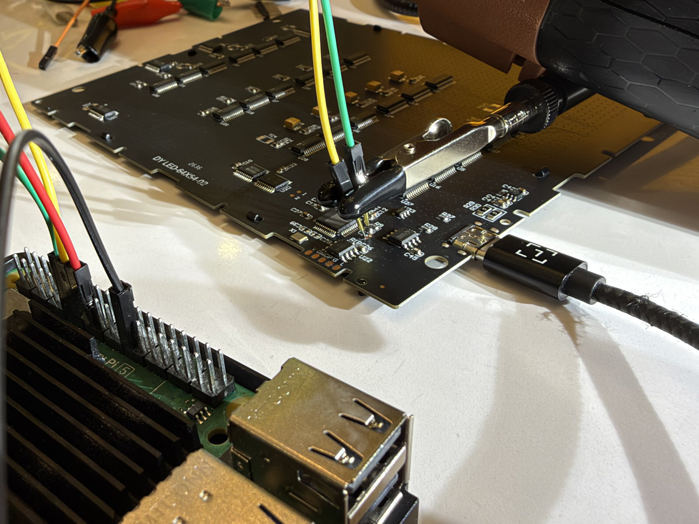
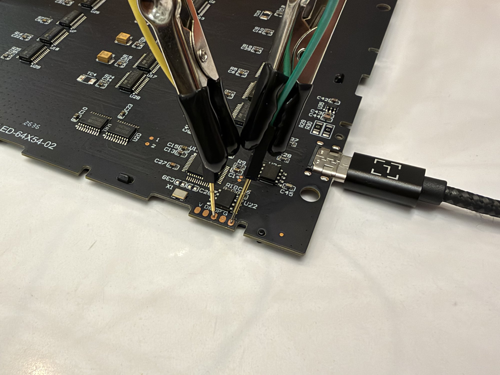

# Trying to get at the MCU over SWD

The flash chip turned out to have no firmware on it, so the firmware is inside U11, the MCU with its markings sanded off. If it's an ARM chip and the debug port's open, SWD would let me read it out and finally see what the thing actually does. So I spent the rest of the night poking every pad I could reach with pogo pins on a Raspberry Pi. Spoiler, nothing answered.

Read-only the whole time. `../tools/swd-pi5.cfg` only runs `dap info`, which asks the debug port what it is. There's no target defined, so OpenOCD never halts, resets, flashes, unlocks or touches option bytes. Don't add any of that unless you're OK losing the firmware, on a lot of these chips unlocking means a mass erase.

The pads I'm talking about are marked in `photos/swd-pads-marked.jpg`: A (upper) and B (lower) are the two little round pads below C14, G is the ground pad on the bottom header. Raw output from every step is in `swd-logs/`.



## Setup

Same Pi 5 as the flash dumps. OpenOCD 0.12+dev from apt with the `linuxgpiod` driver. The stock Pi 5 config puts SWCLK and SWDIO on GPIO 11 and 8, which are the SOIC clip's SPI pins on my bench, so `swd-pi5.cfg` uses GPIO 22 (header pin 15) and GPIO 27 (header pin 13) instead. Set `/sys/module/pcie_aspm/parameters/policy` to performance first, the stock config warns the first pulses come out way too fast otherwise.

The panel runs off the Pi's USB for power and a shared ground, clip off U22, 3.3 V jumper off pin 17.

```
sudo openocd -f tools/swd-pi5.cfg
gpiomon -c 0 22 27        # watch both lines for edges
```

## s1, pad voltages

My meter, black on G, panel running:

| pad | volts |
|---|---|
| A | ~3.3 |
| B | ~3.3 |

Both high. ARM SWD usually has SWDIO pulled up and SWCLK pulled down, so this doesn't match the textbook. Could be a chip that pulls both up, a UART (idles high), or one of them being the 3.3 V rail. The rail had to be ruled out before I let a Pi pin drive either pad low.

## s2, neither pad is a rail

Panel unplugged, continuity (`photos/swd-s2-pin8.jpg`): A to U22 pin 8 (VCC), B to pin 8, A to G, B to G, no beep on any of them. I wasn't totally sure of those beeps so I redid it on ohms after checking the meter on a known pair: A to pin 8 = OL, B to pin 8 = OL. Both are signal lines held high by pull-ups, safe for a Pi GPIO. (With USB plugged in they beep, but that's a meter on a powered board, it means nothing.)

## s3, A and B: no SWD answer either way round

Pogos on A → Pi pin 13 (GPIO 27) and B → Pi pin 15 (GPIO 22), panel on the Pi's USB (`photos/swd-s3-pi-header.png`).

- Unpowered, both lines read low. Panel plugged in, both read high, same as the meter.
- Running, 10 s of edge capture on both lines: 0 edges. Nothing chatters on its own (`swd-s3-idle.txt`, empty on purpose).
- B = SWCLK, A = SWDIO: `Error connecting DP: cannot read IDR` (`swd-s3-probe-a.txt`).
- Swapped, A = SWCLK, B = SWDIO: same (`swd-s3-probe-b.txt`).
- Panel answered a screen-on ping afterwards.

Then the boot (`swd-s3-boot.txt`; my first try at this gave gpiomon a bias option it doesn't have, that's `swd-s3-listen.txt`). Unplugged the panel for ~0.7 s and plugged it back in: 412 edges over 3.2 s, 103-104 per line per direction, and all but 4 come in pairs with the other line within a millisecond, same direction. So for ~2.5 s after plug-in both lines rose and fell together, about every 25 ms, then settled high. That's not a UART, which toggles one line on its own in byte-shaped bursts. It looks more like the pull-ups' supply bouncing while the board comes up. The odd ones out: a 48 µs high pulse on B at 2.39 s and two rising edges on A at the very end.

So A and B are pulled up, quiet once running, no ARM SWD answer either way round, and not a UART. They could still be debug pins with SWD turned off by the firmware (then you'd have to connect while the chip's held in reset, and I don't have a reset line), or a debug protocol that isn't ARM's. WCH's RISC-V parts for example use their own 2-wire thing OpenOCD's SWD doesn't speak. Or they're just not debug at all, two quiet pulled-up lines also look a lot like I2C.

## s4, pads 1 and 2

The two round pads silkscreened "1" and "2" between U20 and U11 (`photos/swd-s4-pads12.jpg`, `photos/board-u11-u20.jpg`):

| | P1 | P2 |
|---|---|---|
| volts to G, panel on USB | 34.5 mV | 48 mV |
| ohms to U22 pin 8, unplugged | OL | OL |
| ohms to G, unplugged | OL | OL |

Low while running but not shorted to ground and not the rail. Opposite of A and B.

## s5, P1 and P2 are busy outputs, not debug

Pogos on P1 → Pi pin 13 and P2 → Pi pin 15, Pi pins as inputs the whole time, 120 s of gpiomon (`swd-s5-boot.txt.gz`, 8.5 million edges, it's big).

- While the panel runs, both lines toggle nonstop at 73,000-111,000 edges a second, which is as fast as the Pi can count, so the real rate's higher. Rising and falling counts don't match so it was dropping events.
- It comes in bursts: P2 busy for the first ~24 s and the last ~7 s, quiet in between, P1 busy most of the time with gaps of a few seconds. Could be the display changing what it's doing, or a pogo losing contact for a moment, I wasn't sure of contact.
- The meter's ~40 mV is just the average of a fast, mostly-low signal.

These look like the MCU driving the LED chain through U20 (a 74HC245, the traces run that way). I didn't run OpenOCD on them, that'd mean driving against the MCU's own outputs.

## s6, L and DP

My pad tests from 2026-10-09 (a stripped USB cable on DM/DP, the L strap) were taped wires, so I didn't trust them much. Pogos this time: L → Pi pin 13, DP → pin 15, nothing on V, panel on the Pi's USB.



- To check contact I flipped the Pi's own bias (disabled / pull-down / pull-up) and read the pin back. First seat had L floating (followed the bias). Second had pin 13 held hard low, probably slipped onto G next door. Third seat: L reads high under every bias, DP reads low under every bias. That's real contact, and it's the textbook SWD rest state (SWDIO pulled up, SWCLK pulled down).
- Boot capture (`swd-s6-boot.txt`, taken on the first seat so only DP counts): one 30 ms burst of 418 edges on DP right at plug-in, then nothing. Plug-in bounce or the MCU touching its USB pin at startup, can't tell which.
- L = SWDIO, DP = SWCLK: `cannot read IDR` (`swd-s6-probe-a.txt`).
- Swapped: same (`swd-s6-probe-b.txt`).
- Panel answered screen-on afterwards, lines back at the same rest levels.

One gap in all of this: the Pi side (`swd-pi5.cfg`, linuxgpiod on a Pi 5) hadn't been checked against anything known to answer. So every "no answer" so far could partly be the probe.

## s7, L and DM

Pin 15's pogo moved from DP to DM. L still reads high under every bias. DM follows the Pi's bias, which is what an undriven pin does (the old 0.11 V fits) but also what no contact looks like, so contact on DM isn't proven. `dap info` both ways round: `cannot read IDR` (`swd-s7-probe-a.txt`, `swd-s7-probe-b.txt`).

That's three pad pairs with nothing (A/B, L/DP, L/DM), so I stopped trying pads and checked the probe instead.

## s8, the probe's clock does come out

Jumper from Pi pin 15 (GPIO 22, SWCLK) to pin 16 (GPIO 23) (`photos/swd-s8-pi-loopback.png`), gpiomon on GPIO 23 while OpenOCD ran (`swd-s8-loop.txt`): 26,096 edges in 513 ms, median 8.4 µs apart, so about a 60 kHz clock (gpiomon may drop some). OpenOCD still said `cannot read IDR`, as it would with nothing on the other end.

So the Pi really does drive SWCLK. That doesn't prove SWDIO or the whole protocol end to end, I don't have a known-good ARM board here, but it rules out the dumb "no pulses at all" failure. If you've got a Pico or any ARM dev board, wiring it to the same two pins and getting an IDR back would close that gap.

## s9, mapping U11's legs

Panel unplugged, continuity, legs numbered from the dot (`photos/u11-legs-numbered.jpg`: pin 1 = top leg on the left side with the board the way `board-u11-u20.jpg` shows it, counterclockwise).

Every leg against G: **1, 12, 13, 36** beep.

The STM32F1/F0 48-pin layout, which GD32, AT32, APM32 and WCH's CH32F/CH32V parts all copy, has ground on 8, 23, 35 and 47. This doesn't match, so U11 most likely isn't from that family. My guess, not checked: an 8051-type LED panel MCU (STC8H, WCH CH55x and the like). Those don't have SWD at all, they load firmware over USB or UART with a strap held at power-up. That alone would explain every silent probe without any lock.

I tried to find the 3.3 V and 5 V legs too, but a sanity check (U22 pin 8 to C26 and to U34's output, `photos/swd-s9-c26.jpg`) didn't beep either, so my probe wasn't landing on pin 8 and those passes don't count. Didn't redo them.

## Where it ended

No debug port answered on any pad I could reach: A/B (below C14), L/DP and L/DM (bottom header), each both ways round. P1/P2 are busy outputs and I left them alone. The Pi's SWD clock showed up on a loopback, so the probe drives the pins, it just never got tried on a known-good target.

U11's ground legs don't match the STM32-style layout. Two readings fit what I saw and the bench can't tell them apart:

- an ARM part with its debug port locked for good (STM32 RDP level 2 or a clone's version of it). SWD goes completely silent, exactly like this. The pinout argues against that family though.
- a part with no SWD at all, like those 8051-type LED controller chips, which usually can't read their flash back either.

Either way I can't read the firmware with what's on my bench. Telling them apart needs U11's power legs (redone with solid contact on the rail) and then that family's datasheet. If you recognize a 48-pin LQFP with ground on 1, 12, 13 and 36, please tell me. Nothing was ever written to the MCU, and the panel answered normally after every step.
